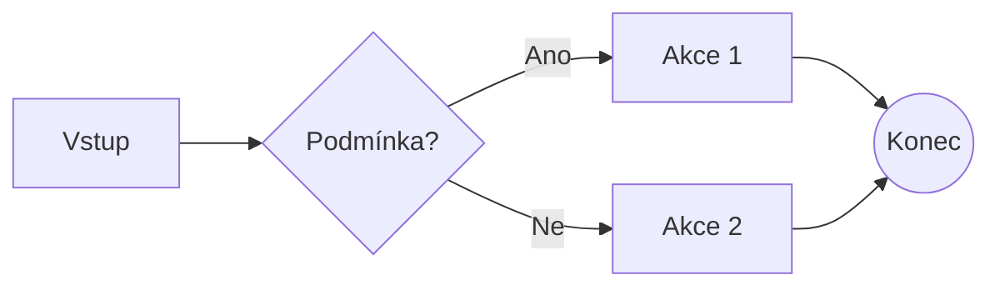
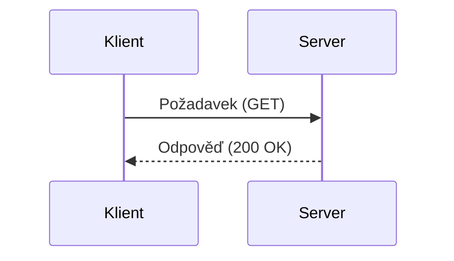

# NOTES

* tento dokument je vytvořený pouze pro ukládání dat které díky mojí paměti zlaté rybičky nedokážu udržet v hlavě. Nejspíš nebude dobře strukturovaný a je možné, že bude obsahovat chyby, gramatické chyby, nedokonlosti a vulgarizmy. 


# Tahák Markdown

## Obsah
- [Základní formátování](#základní-formátování)
- [Seznamy a odškrtávací body](#seznamy-a-odškrtávací-body)
- [Bloky kódu](#bloky-kódu)
- [Tabulky](#tabulky)
- [Grafy a diagramy (Mermaid)](#grafy-a-diagramy-mermaid)
- [Matematika (LaTeX)](#matematika-latex)
- [Další vychytávky](#další-vychytávky)

---

## Základní formátování

| Syntaxe | Výsledek / Funkce |
| :--- | :--- |
| `# H1` až `###### H6` | Nadpisy úrovně 1 až 6 |
| `**text**` | **Tučné písmo** |
| `*text*` | *Šikmé písmo (kurzíva)* |
| `***text***` | ***Tučná kurzíva*** |
| `~~text~~` | ~~Přeškrtnutý text~~ |
| `` `kód` `` | Inline kód v řádku |
| `[popisek](https://url.cz)` | Klikací odkaz |
| `[sekce](#název-nadpisu)` | Odkaz na nadpis v dokumentu |
| `` | Vložení obrázku |
| `> text` | Citace / zvýrazněný blok |
| `---` | Vodorovná oddělovací čára |
| `\*text\*` | Zpětné lomítko vypne formátování |

---

## Seznamy a odškrtávací body

**Odrážky a zanoření (odsazení 2 mezery nebo Tab):**
- Položka 1
  - Podpoložka 1.1
- Položka 2

**Číslovaný seznam:**
1. První krok
2. Druhý krok

**Odškrtávací body (Task list):**
- [ ] Neudělaný úkol
- [x] Hotový úkol

---

## Bloky kódu

**Terminál (`bash` / `sh`):**
```bash
g++ -Wall -Wextra -O2 main.cpp -o program
./program
```

**C++ (`cpp`):**
```cpp
#include <iostream>

int main() {
    std::cout << "Hello World\n";
    return 0;
}
```

---

## Tabulky

Zarovnání sloupců určují dvojtečky na druhém řádku (`:---` vlevo, `:---:` na střed, `---:` vpravo):

| Sloupec vlevo | Sloupec na střed | Sloupec vpravo |
| :--- | :---: | ---: |
| Data A | 10 | 100 Kč |
| Data B | 20 | 250 Kč |

---

## Grafy a diagramy (Mermaid)

**Vývojový diagram (Flowchart):**


**Sekvenční diagram (např. komunikace mezi moduly):**


---

## Matematika (LaTeX)

| Syntaxe | Výsledek / Funkce |
| :--- | :--- |
| `$E = mc^2$` | Vzorec v řádku |
| `$$\int_0^\infty e^{-x} dx = 1$$` | Samostatný centrovaný vzorec |

---

## Další vychytávky

**Sbalovací sekce (ideální na schování tohoto taháku nebo dlouhých logů):**
<details>
<summary>Klikni pro rozbalení</summary>

Tady může být jakýkoliv Markdown text, kód nebo obrázek (nech prázdný řádek pod `</summary>`).

</details>

**Barevné boxy / Callouts (GitHub, Obsidian):**
> [!NOTE]
> Běžná poznámka.

> [!TIP]
> Užitečný tip.

> [!WARNING]
> Varování před chybou nebo problémem.

**Poznámka pod čarou:**
Text s odkazem na poznámku[^1].

[^1]: Vysvětlení dole na stránce.

# HARDWARE

BUCK
3,3V … https://cz.mouser.com/cs/ProductDetail/Texas-Instruments/TLV62568PDRLT?qs=0C8XhJW8e4oKFfzu2XrS3g%3D%3D
1,2V … stejný

VOLTAGE LEVEL TRANSLATOR	
4_pin … https://cz.mouser.com/en/ProductDetail/Texas-Instruments/SN74AXC4T774BQBR?qs=KUoIvG%2F9IlanPyIekKfmTQ%3D%3D
2_pin … https://cz.mouser.com/en/ProductDetail/Texas-Instruments/TCA39306DCUR?qs=Wj%2FVkw3K%252BMBjyHfLT3ea4A%3D%3D

DIODY
cervena … https://cz.mouser.com/en/ProductDetail/LITEON/LTST-C190KRKT?qs=kAD5fFa1n5VY3YYNWPC1Fg%3D%3D
zluta … https://cz.mouser.com/en/ProductDetail/LITEON/LTST-C190KSKT?qs=ebQBSvamkgydgzdxPGqIeg%3D%3D
zelena … https://cz.mouser.com/en/ProductDetail/LITEON/LTST-C190KGKT?qs=205qCy6M2Q%252BAdcgwUZktqw%3D%3D


 --- POZNÁMKY ---

- piny pro logiku a vykonnou část je dostatecne deleni (více by bylo zbytečné)
- kabely na nucleo napajet a k PCB je pripojit konektorem JST-GH (koupit 10pin s druhou stranou volnou a dostatecne dlouhy kabel, aby se dal zkratit pa nozadovanou delku a zakroutit
- je nutne pripajet odpor na spojeni kabelu s nucleem. Nutno vypočítat a dobře propojit (krátké nožičky a mechanicky odolné)
- PG je 3,3V pokud buck dava vice jak 95% pozadovane hodnoty a 0V pokud tam je pod 90% 
- u 4 pin transformatoru napeti si musim kontrolovat zda piny sedi s tim co obednavam. Muze se to menit. 


 --- TO DO ---

- Je potřeba nastavit R15 a C12 … kdyby tam nebyl ten odpor tak by mohl kondenzátor rozkmitat 

 --- KICAD ---

- d … posunuti dratu
- e … nastavení
- b … zaplnění oblastí 

# SOFTWARE

## Spuštění simulace

Hodně tématy jsem si tady nebyl jiśtý a tak si budu nejprve zapisovat nestrukturovane informace a potom to zmenim do nejakeho navodu, typů, věcí co jsou důležité a potřebné dovysvětlit

### Dočasný seznam